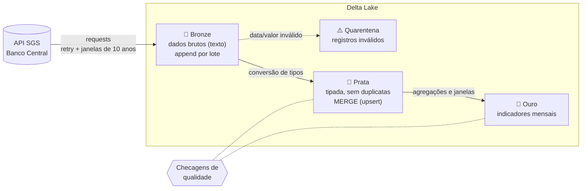

# Pipeline de Indicadores Econômicos do Banco Central

[](https://github.com/brnsar/pipeline-indicadores-bcb/actions/workflows/ci.yml)


Pipeline de dados em **PySpark + Delta Lake** que coleta **dólar, taxa Selic e IPCA** da API pública do Banco Central, organiza tudo em uma **arquitetura medalhão (bronze → prata → ouro)** e entrega uma tabela mensal pronta para análise, com IPCA acumulado em 12 meses e juro real.

O foco do projeto é o que separa um script de um pipeline de produção: **carga incremental**, **reprocessamento sem duplicar dados**, **quarentena de registros inválidos**, **checagens de qualidade** que bloqueiam a gravação e **testes automatizados** rodando no GitHub Actions.

## Arquitetura



| Camada | Tabela | O que guarda | Como grava |
|---|---|---|---|
| Bronze | `bronze/sgs` | Resposta da API sem alteração, com `_lote_id` e `_ingerido_em` | `append`, particionada por série |
| Quarentena | `bronze/quarentena` | Registros com data ou valor impossível de converter | `append` |
| Prata | `prata/indicadores` | Uma linha por (série, data), com tipos corretos | `MERGE` |
| Ouro | `ouro/indicadores_mensais` | Uma linha por mês, com os indicadores calculados | `overwrite` |

### Séries coletadas

| Série | Código SGS | Unidade | Periodicidade |
|---|---|---|---|
| Dólar comercial (venda) | 1 | R$/US$ | Diária |
| Meta Selic (Copom) | 432 | % a.a. | Diária |
| IPCA | 433 | % no mês | Mensal |

As séries ficam em [`config.py`](src/bcb_pipeline/config.py). Para incluir uma nova, basta adicionar uma linha com o código do SGS.

### Tabela ouro: `indicadores_mensais`

| Coluna | Descrição |
|---|---|
| `mes` | Primeiro dia do mês |
| `dolar_medio` | Média do dólar no mês |
| `dolar_fechamento` | Último valor do dólar no mês |
| `dolar_var_mensal_pct` | Variação do fechamento em relação ao mês anterior (%) |
| `selic_meta` | Meta Selic vigente no fim do mês (% a.a.) |
| `ipca_mensal` | IPCA do mês (%) |
| `ipca_12m` | IPCA acumulado em 12 meses (%), calculado só quando os 12 meses existem |
| `juro_real_12m` | Juro real ex-post: Selic descontada do IPCA de 12 meses (%) |

## Decisões de engenharia

- **Carga incremental com janela de reprocessamento.** Sem `--inicio`, o pipeline consulta a camada prata, descobre a última data de cada série e busca de novo os últimos 45 dias. Assim, correções publicadas pelo BCB são capturadas.
- **Idempotência com `MERGE`.** Reprocessar o mesmo período não duplica linhas. Datas novas são inseridas e valores que mudaram são atualizados, registrando o lote responsável pela alteração.
- **Bronze imutável.** Os dados chegam como texto, exatamente como a API respondeu. Isso permite auditar e reprocessar qualquer lote sem chamar a API de novo.
- **Quarentena em vez de falha.** Um registro malformado não derruba o pipeline: ele é separado, registrado em log e guardado para análise.
- **Checagens de qualidade bloqueantes.** Antes de gravar, o pipeline verifica nulos, chave única, séries conhecidas, valores dentro de faixas plausíveis (um dólar a R$ 489 indica separador decimal perdido) e datas futuras. Se alguma falhar, nada é gravado.
- **Extração resiliente.** A API limita consultas a 10 anos, então o período é dividido em janelas. Erros temporários (429, 5xx, timeout, resposta que não é JSON) disparam novas tentativas com espera exponencial. Erros definitivos (400) falham na hora.
- **Cálculos corretos em séries com buracos.** O IPCA de 12 meses usa uma janela por intervalo de meses, não por número de linhas, e a variação do dólar só compara meses consecutivos. Um mês faltando não gera um número errado.
- **Transformações separadas da gravação.** As funções em [`transform.py`](src/bcb_pipeline/transform.py) recebem e devolvem DataFrames, o que permite testá-las sem Delta Lake.

## Como rodar

Pré-requisitos: **Python 3.10 a 3.12** e **Java 17**. Na primeira execução, o Spark baixa automaticamente os JARs do Delta Lake.

```bash
git clone https://github.com/brnsar/pipeline-indicadores-bcb.git
cd pipeline-indicadores-bcb
python -m venv .venv && source .venv/bin/activate
pip install -e ".[dev]"
```

```bash
# Carga inicial a partir de 2015
bcb-pipeline --inicio 2015-01-01 --mostrar

# Execuções seguintes: incremental (busca só o que é novo)
bcb-pipeline --mostrar

# Reprocessar um período específico de uma série
bcb-pipeline --series dolar --inicio 2024-01-01 --fim 2024-06-30
```

| Opção | Descrição |
|---|---|
| `--lake` | Pasta do data lake (padrão: `./lake`) |
| `--inicio` / `--fim` | Período no formato `AAAA-MM-DD` (padrão: incremental até hoje) |
| `--series` | Processa só algumas séries: `dolar`, `selic_meta`, `ipca` |
| `--mostrar` | Exibe os últimos 12 meses da camada ouro |
| `-v` | Logs detalhados |

### Consultando os dados

```python
from bcb_pipeline.spark import criar_spark

spark = criar_spark()
ouro = spark.read.format("delta").load("lake/ouro/indicadores_mensais")
ouro.createOrReplaceTempView("indicadores")

spark.sql("""
    SELECT mes, dolar_medio, selic_meta, ipca_12m, juro_real_12m
    FROM indicadores
    WHERE mes >= '2024-01-01'
    ORDER BY mes
""").show()

# Histórico de versões da tabela (time travel do Delta Lake)
spark.sql("DESCRIBE HISTORY delta.`lake/prata/indicadores`").show(truncate=False)
```

## Testes

```bash
pytest -v
```

São 23 testes, que rodam a cada envio pelo [GitHub Actions](.github/workflows/ci.yml):

- **Extração:** divisão do período em janelas, formato dos parâmetros, novas tentativas com espera, desistência após o limite e tratamento de 404 e 400.
- **Transformações:** conversão de tipos, quarentena, remoção de duplicatas e cálculos da camada ouro. O IPCA acumulado de 2023 calculado pelo pipeline é comparado com o valor oficial do IBGE (4,62%).
- **Qualidade:** cada checagem detecta o problema que deveria detectar.
- **Ponta a ponta com Delta Lake:** uma carga inicial e uma incremental em sequência, verificando que não há duplicatas, que uma correção de valor é aplicada, que o registro inválido vai para a quarentena e que a bronze guarda os dois lotes.

Os testes não acessam a internet: a API é substituída por uma fonte falsa com dados controlados.

## Estrutura

```
├── src/bcb_pipeline/
│   ├── config.py      # séries do BCB e parâmetros
│   ├── extract.py     # cliente da API SGS (janelas, retry, backoff)
│   ├── transform.py   # transformações bronze → prata → ouro
│   ├── quality.py     # checagens de qualidade
│   ├── pipeline.py    # orquestração e gravação em Delta (append, MERGE, overwrite)
│   ├── spark.py       # SparkSession com Delta Lake
│   └── cli.py         # comando bcb-pipeline
├── tests/             # testes com pytest
├── .github/workflows/ # CI
└── pyproject.toml
```

## Próximos passos

- Agendar a execução diária com Airflow ou Databricks Workflows.
- Adicionar novas séries, como o IGP-M (189) e o CDI (12).
- Publicar a camada ouro em um dashboard.

## Autora

**Bruna Soares**: [brnsar6@gmail.com](mailto:brnsar6@gmail.com) · [GitHub](https://github.com/brnsar)

Dados: [Banco Central do Brasil, SGS](https://www3.bcb.gov.br/sgspub/).
